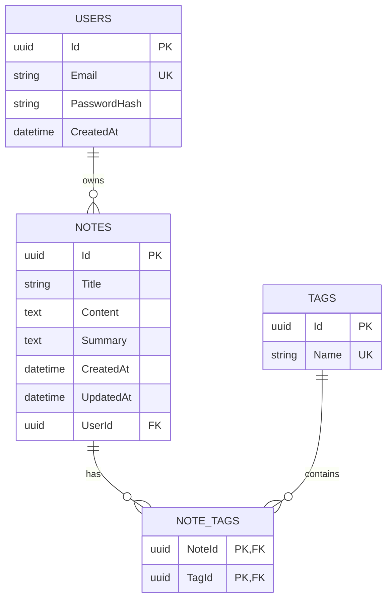

# AI Destekli Not API'si

Bu projeyi, kullanıcıların güvenli şekilde not oluşturabildiği, notlarını arayıp sayfalayabildiği ve OpenAI ile notlarını özetleyip etiketleyebildiği full-stack bir uygulama olarak geliştirdim.

## Proje Yapısı

```text
AiNotes.Api/       ASP.NET Core Web API
AiNotes.Client/    React + Vite + Tailwind frontend
docker-compose.yml SQL Server container tanımı
```

## Teknolojiler

- Backend: ASP.NET Core Web API, .NET 10, C#
- Veri erişimi: Entity Framework Core, SQL Server
- Kimlik doğrulama: JWT Bearer, BCrypt.Net-Next
- Yapay zeka: OpenAI Chat Completions API, `IHttpClientFactory`
- Frontend: React, TypeScript, Vite, Tailwind CSS, React Router
- Dokümantasyon: Swagger / OpenAPI
- Geliştirme veritabanı: Docker Compose ile SQL Server 2022

## Gereksinimler

- .NET SDK 10
- Docker Desktop
- Node.js 20 veya üzeri
- OpenAI API anahtarı (özetleme ve etiket önerme için)

## Kurulum

### 1. SQL Server'ı başlat

Proje kökünde, yani `docker-compose.yml` dosyasının bulunduğu klasörde:

```powershell
Copy-Item .env.example .env
# .env içindeki MSSQL_SA_PASSWORD değerini güçlü bir yerel şifreyle değiştir
docker compose up -d
```

Container durumunu kontrol et:

```powershell
docker ps
```

### 2. User-secrets tanımla

API klasörüne geç:

```powershell
cd .\AiNotes.Api
```

JWT secret ve OpenAI anahtarını user-secrets içinde tut:

```powershell
dotnet user-secrets set "Jwt:Key" "en-az-32-karakterlik-gelistirme-secret"
dotnet user-secrets set "OpenAI:ApiKey" "OPENAI_API_KEY_BURAYA"
```

İstersen SQL Server parolasını da appsettings yerine user-secrets ile override edebilirsin:

```powershell
dotnet user-secrets set "ConnectionStrings:DefaultConnection" "Server=localhost,1433;Database=AiNotesDb;User Id=sa;Password=YourStrong@Passw0rd;TrustServerCertificate=True;"
```

### 3. Migration ve API

```powershell
dotnet ef database update
dotnet run
```

API varsayılan olarak `http://localhost:5100` adresinde çalışır.

Swagger:

```text
http://localhost:5100/swagger
```

### 4. Frontend

Yeni bir terminalde:

```powershell
cd "..\AiNotes.Client"
npm.cmd install
npm.cmd run dev
```

Windows PowerShell `npm.ps1` çalıştırılmasını engelliyorsa `npm` yerine `npm.cmd` kullan. Alternatif olarak `AiNotes.Client/start-frontend.cmd` dosyasını çalıştırabilirsin.

Frontend:

```text
http://localhost:5173
```

## API Endpoint'leri

### Auth

| Method | Endpoint | Açıklama | Auth |
|---|---|---|---|
| `POST` | `/api/Auth/register` | Email ve şifre ile kayıt | Hayır |
| `POST` | `/api/Auth/login` | JWT token alır | Hayır |

Register örneği:

```json
{
  "email": "user@example.com",
  "password": "Password123!"
}
```

Login yanıtındaki `token`, Swagger'daki **Authorize** butonuna girilir.

### Notes

| Method | Endpoint | Açıklama | Auth |
|---|---|---|---|
| `POST` | `/api/Notes` | Not oluşturur | Evet |
| `GET` | `/api/Notes` | Kullanıcının notlarını listeler | Evet |
| `GET` | `/api/Notes/{id}` | Not detayını getirir | Evet |
| `PUT` | `/api/Notes/{id}` | Notu günceller | Evet |
| `DELETE` | `/api/Notes/{id}` | Notu siler | Evet |
| `POST` | `/api/Notes/{id}/summarize` | OpenAI ile özetler ve kaydeder | Evet |
| `POST` | `/api/Notes/{id}/suggest-tags` | OpenAI ile en fazla 5 etiket önerir | Evet |

Listeleme ve arama örneği:

```text
GET /api/Notes?search=python&page=1&pageSize=10
```

Tüm note endpoint'leri JWT'deki `UserId` claim'ini kullanır. Kullanıcı başka bir kullanıcıya ait notun ID'sini gönderirse servis notu kendi `UserId` filtresiyle bulamaz ve `404 Not Found` döner.

OpenAI çağrısı başarısız olursa API çökmez; endpoint `502 Bad Gateway` ve ProblemDetails formatında anlamlı bir hata döndürür.

## Veritabanı Şeması

Tablolar:

| Tablo | Önemli alanlar |
|---|---|
| `Users` | `Id`, `Email`, `PasswordHash`, `CreatedAt` |
| `Notes` | `Id`, `Title`, `Content`, `Summary`, `CreatedAt`, `UpdatedAt`, `UserId` |
| `Tags` | `Id`, `Name` |
| `NoteTags` | `NoteId`, `TagId` birleşik primary key |

İlişkiler:

- Bir `User` birçok `Note` sahibi olabilir.
- Bir `Note` birçok `Tag` taşıyabilir.
- Bir `Tag` birçok `Note` içinde kullanılabilir.
- `NoteTags`, `Note` ve `Tag` arasındaki çoktan çoğa ilişkiyi kurar.
- Email ve tag adı unique olarak indekslenmiştir.
- Kullanıcı silinirse kendi notları cascade delete ile silinir.



```


